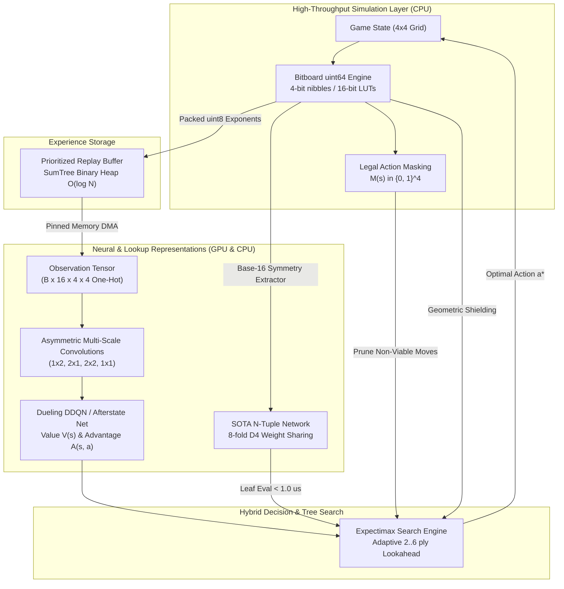

# Deep-2048-RL: Autonomous Deep Reinforcement Learning for 2048

<p align="center">
  <a href="https://github.com/lobero21/deep-2048-rl/actions"></a>
  <a href="https://python.org"></a>
  <a href="https://pytorch.org"></a>
  <a href="https://developer.nvidia.com/cuda-gpus"></a>
  <a href="LICENSE"></a>
  <a href="https://github.com/psf/black"></a>
</p>

An enterprise-grade, high-performance Deep Reinforcement Learning (DRL) system designed to master the combinatoric game **2048** from scratch without handcrafted heuristics. The system features a synchronized trifecta architecture combining:
- **Dueling Double Deep Q-Networks (DDQN)** with multi-scale asymmetric convolutions and native **Afterstate Value Learning** ($s \to s_{\text{after}} \to s'$).
- **Prioritized Experience Replay (PER)** with compact `uint8` RAM storage and importance sampling.
- **64-Bit Bitboard Engine** with precomputed 16-bit transition lookup tables ($> 485,000\text{ moves/sec}$).
- **SOTA N-Tuple Network** with 8-fold Dihedral $D_4$ symmetric weight sharing and sub-microsecond leaf evaluations ($< 1\ \mu\text{s}$).
- **Expectimax Lookahead Tree Search** (Adaptive 2..4 ply and Apex 5..6 ply) with canonical Transposition Tables, chance node probability pruning, and **Protected Policy-Guided Action Pruning**.
- **Bitwise Geometric Shields:** Precomputed Manhattan Smoothness ($S_{\text{smooth}}$) and Trapped Low-Tier Wedge Detection ($P_{\text{trapped}}$).
- **Hardware Acceleration:** Native TensorFloat-32 (TF32) and asynchronous pinned DMA memory transfers optimized for NVIDIA Ampere architecture (RTX 3060).

---

## High-Level Architecture



---

## Key Features

- **Zero Handcrafted Heuristics:** The agent discovers topological corner-packing strategies, monotonicity gradients, and cascade combinations autonomously through log-scaled fusion rewards ($r = \sum \log_2(v_{\text{merged}})$) and long-term expected Bellman return optimization ($\gamma = 0.99$).
- **64-Bit Bitboard Engine:** Single `uint64` board representation with 4-bit nibbles and precomputed 16-bit row transition LUTs achieving $> 485,000\text{ moves/s}$ per CPU core in pure Python.
- **Microsecond N-Tuple Leaf Evaluation:** Canonical 4-line, 6-rect, and 6-snake geometric patterns with base-16 addressing and $D_4$ weight sharing, evaluating board positions in **$< 1.0\ \mu\text{s}$** ($> 1,100,000\text{ boards/s}$) to eliminate GPU forward latency bottlenecks during deep tree search.
- **N-Tuple TD($\lambda$) Self-Play Training Pipeline:** Pure CPU self-play training engine running at $> 12,500\text{ steps/s}$ with afterstate Bellman updates $\delta = r_{\text{next}} + (1 - d)\gamma V(s'_{\text{after}}) - V(s_{\text{after}})$ and linear $\alpha$ decay.
- **Deep Expectimax Search:** High-throughput lookahead search engine with canonical Dihedral $D_4$ Transposition Tables, beam search, and chance node probability pruning ($p < 0.001$).
- **Adaptive & Apex Depth Selection:** Dynamically scales lookahead depth from 2-ply in open boards, to 3-ply and 4-ply in mid-to-late games, up to 5-ply / 6-ply search in apex endgames.
- **Protected Policy-Guided Action Pruning:** Prunes non-viable branches ($\pi(a \mid s) < \tau$) at shallow plies, with a strict safety bypass in danger states (empty cells $\le 4$ or max tile $\ge 2048$) to ensure complete evaluation of all legal moves.
- **Manhattan Smoothness & Trapped Wedge Shield:** Precomputed 65,536-entry LUT evaluating rank continuity ($S_{\text{smooth}}$) and detecting outer-wall low-tier wedges ($P_{\text{trapped}}$) flanked by high-value tiles.
- **Native Afterstate Value Learning:** Decomposes transitions into $s \to s_{\text{after}} \to s'$, optimizing $V(s_{\text{after}})$ directly to completely isolate environmental spawn stochasticity from policy evaluation.
- **Synchronous Vectorized Engine:** `VectorizedGame2048Env` simulating $N$ concurrent board states simultaneously with auto-resetting sub-environments.
- **Multi-Channel Tensor Representation:** Multi-plane binary state encoding ($\mathbf{X} \in \mathbb{R}^{B \times 16 \times 4 \times 4}$) that maps tile powers $2^k$ to discrete convolutional channels with strict spatial partition of unity.
- **Dueling Double DQN Architecture:** Decoupled value $V(s)$ and advantage $A(s, a)$ streams driven by asymmetric multi-scale convolutional kernels ($(1, 2)$, $(2, 1)$, $(2, 2)$, $(1, 1)$) with centered identifiability aggregation.
- **Prioritized Experience Replay (PER):** $\mathcal{O}(\log N)$ SumTree buffer storing states as compact `uint8` exponents in RAM ($< 180\text{ MB}$ for $100,000$ transitions) with Importance Sampling (IS) weights.
- **NVIDIA Ampere Acceleration:** Native support for TensorFloat-32 (TF32) matmul/cudnn backends, non-blocking pinned memory DMA transfers (+34.4% PCIe transfer speedup), and optimization throughput exceeding $166,000\text{ samples/s}$ on RTX 3060.
- **Telemetry & Production Export:** Real-time TensorBoard telemetry, ANSI terminal playback visualizer, Monte Carlo evaluator, and ONNX model export with parity verification ($< 10^{-7}$ error).

---

## Repository Structure

```text
Deep-2048-rl/
├── GEMINI.md                           # System operations & engineering protocol
├── README.md                           # Executive summary and documentation
├── ARCHITECTURE.md                     # Component design, lifecycles, and concurrency
├── CONTRIBUTING.md                     # Development workflows and standards
├── CHANGELOG.md                        # Version baseline & release history
├── SECURITY.md                         # Security policies and vulnerability disclosures
├── CODE_OF_CONDUCT.md                  # Contributor code of conduct
├── pyproject.toml                      # Packaging & test specifications
├── requirements.txt                    # Direct Python dependencies
├── docs/                               # Detailed technical documentation
│   ├── environment.md                  # MDP formulation, observation spaces, bitboard & shields
│   ├── architecture.md                 # Dueling DQN, N-Tuple Network & hybrid leaf evaluation
│   ├── training_pipeline.md            # DDQN, Afterstate learning, PER & N-Tuple TD(lambda)
│   ├── gpu_optimization.md             # TF32 profiling & CUDA pipeline scaling
│   ├── benchmarks.md                   # Empirical throughput & latency benchmarks
│   └── evaluation.md                   # Telemetry, CLI visualizer & ONNX deployment
├── scripts/                            # Standalone operational tools & runners
│   ├── benchmark_hardware.py           # Hardware throughput & PCIe profiling suite
│   ├── evaluate.py                     # Monte Carlo statistical evaluator (hybrid search)
│   ├── play.py                         # Interactive ANSI terminal viewer & HUD
│   ├── train_ntuple.py                 # N-Tuple TD(lambda) self-play training CLI
│   └── export_onnx.py                  # ONNX export & parity validation CLI
├── src/                                # Core production source code
│   ├── __init__.py
│   ├── env/                            # Game simulation and Gymnasium wrappers
│   │   ├── __init__.py
│   │   ├── core.py                     # Pure NumPy 2048 high-speed engine
│   │   ├── bitboard.py                 # 64-bit Bitboard engine, LUTs & smoothness shields
│   │   ├── wrapper.py                  # Gymnasium wrapper & One-Hot encoders
│   │   └── vectorized.py               # Vectorized multi-environment runner
│   ├── models/                         # Neural network & lookup architectures
│   │   ├── __init__.py
│   │   ├── dueling_dqn.py              # PyTorch Dueling DQN network & ONNX exporter
│   │   └── ntuple.py                   # SOTA N-Tuple Network (D4 symmetric lookups)
│   ├── memory/                         # Experience replay structures
│   │   ├── __init__.py
│   │   └── replay_buffer.py            # SumTree / Prioritized Replay Buffer
│   ├── agent/                          # Tree search and inference
│   │   ├── __init__.py
│   │   └── search.py                   # Expectimax searcher & hybrid leaf evaluation
│   ├── training/                       # Agent logic and training loop
│   │   ├── __init__.py
│   │   ├── agent.py                    # DDQN Agent (epsilon-greedy, policy/target nets)
│   │   ├── expert_iteration.py         # Afterstate expert trajectory collector
│   │   ├── train_ntuple.py             # High-throughput N-Tuple TD(lambda) training loop
│   │   ├── trainer.py                  # Trainer orchestrator with TensorBoard logging
│   │   └── train.py                    # Main training CLI entrypoint
│   └── utils/                          # Hardware helpers and CLI viewer
│       ├── __init__.py
│       ├── cuda_utils.py               # TF32 setup & GPU telemetry
│       └── visualizer.py               # ANSI color terminal renderer & HUD
└── tests/                              # Automated pytest suite (120/120 passed)
    ├── test_afterstate_pipeline.py     # Afterstate Bellman target & expert iteration tests
    ├── test_bitboard.py                # 64-bit bitboard LUT parity & afterstate tests
    ├── test_buffer.py                  # PER SumTree sampling & IS weight tests
    ├── test_core.py                    # Core game mechanics & collision edge-cases
    ├── test_env.py                     # Gymnasium API & one-hot encoding tests
    ├── test_evaluation.py              # ANSI rendering & Monte Carlo evaluator tests
    ├── test_export.py                  # ONNX export & runtime parity tests
    ├── test_models.py                  # Neural network dimensions & forward pass tests
    ├── test_ntuple.py                  # N-Tuple D4 symmetries, indexing, TD & microsecond eval
    ├── test_search.py                  # Expectimax search, adaptive depth & policy pruning
    ├── test_smoothness.py              # Manhattan smoothness LUT & trapped wedge detector
    ├── test_training.py                # DDQN Bellman updates & overfitting tests
    └── test_vectorized.py              # Parallel environment & batch replay tests
```

---

## Prerequisites & Installation

### System Requirements
- **OS:** Windows 10/11 or Linux (Ubuntu 22.04+)
- **Python:** 3.11 recommended (CPython 3.11.9 verified)
- **GPU (Optional but recommended):** NVIDIA RTX 3060 (12GB VRAM, Ampere `sm_86`) or higher

### Virtual Environment Setup

```bash
# Clone the repository
git clone https://github.com/lobero21/deep-2048-rl.git
cd deep-2048-rl

# Create and activate virtual environment
python -m venv .venv

# On Windows (PowerShell):
.venv\Scripts\Activate.ps1
# On Linux / macOS:
source .venv/bin/activate

# Install dependencies (core and optional dev/gpu)
pip install -r requirements.txt
pip install -e .
```

---

## CLI Command Suite & Usage Guide

### 1. Launch DDQN Training Pipeline
Train the Double Dueling DQN agent with Ampere TF32 acceleration and TensorBoard logging:

```bash
# Standard training run (2000 episodes, batch size 512)
python src/training/train.py --episodes 2000 --batch-size 512 --checkpoint-dir checkpoints

# Monitor live training progress via TensorBoard
tensorboard --logdir runs
```

### 2. Train SOTA N-Tuple Network via TD($\lambda$) Self-Play
Train the symmetric lookup tables via pure in-memory Bitboard self-play at $> 12,500\text{ steps/sec}$:

```bash
python scripts/train_ntuple.py \
  --episodes 50000 \
  --alpha 0.05 \
  --alpha-min 0.005 \
  --gamma 0.99 \
  --save-path checkpoints/ntuple/ntuple_best.npz \
  --eval-every 5000
```

### 3. Statistical Monte Carlo Evaluation (Calibrated Hybrid Search)
Run deterministic evaluation rollouts with deep tree search, combining the neural Afterstate model, trained N-Tuple lookups, and geometric hazard shields:

```bash
python scripts/evaluate.py \
  --checkpoint checkpoints/afterstate/checkpoint_best.pt \
  --ntuple-path checkpoints/ntuple/ntuple_best.npz \
  --episodes 30 \
  --adaptive-depth \
  --use-d4-symmetry \
  --use-smoothness \
  --use-ntuple \
  --w-ntuple 0.15 \
  --w-smooth 0.10 \
  --w-trap 5.0
```

### 4. Live Interactive ANSI Terminal Visualizer
Watch the agent play in real-time inside your console with color-coded tiles and live Q-value analysis:

```bash
# Automated playback with 100ms step delay
python scripts/play.py --checkpoint checkpoints/checkpoint_best.pt --delay 0.1

# Manual step-by-step playback (press Enter for each action)
python scripts/play.py --checkpoint checkpoints/checkpoint_best.pt --manual-step
```

### 5. Hardware Profiling & Latency Benchmarks
Profile environment stepping throughput, PCIe memory transfers, and GPU compute performance:

```bash
python scripts/benchmark_hardware.py
```

### 6. ONNX Export & Parity Verification
Export the trained model to ONNX format with dynamic batch sizes and verify numerical parity with ONNX Runtime:

```bash
python scripts/export_onnx.py --checkpoint checkpoints/checkpoint_best.pt --output model_2048.onnx
```

### 7. Automated Test Suite Execution
Run the complete automated test suite verifying all 120 test cases:

```bash
pytest tests/ -v
```

---

## Configuration Parameter Matrix

### Training Pipeline (`src/training/train.py`)

| Argument | Type | Default | Description |
| :--- | :---: | :---: | :--- |
| `--episodes` | `int` | `2000` | Total training episodes to simulate |
| `--num-envs` | `int` | `32` | Number of concurrent vectorized environments |
| `--single-env` | `flag` | `False` | Force single-environment sequential training |
| `--batch-size` | `int` | `512` | Mini-batch size for SGD optimization |
| `--lr` | `float` | `1e-4` | Learning rate for AdamW optimizer |
| `--gamma` | `float` | `0.99` | MDP discount factor |
| `--tau` | `float` | `0.005` | Polyak soft update coefficient for target network |
| `--buffer-capacity`| `int` | `100000` | PER replay buffer capacity (stored in RAM) |
| `--warmup-steps` | `int` | `2000` | Initial transitions collected before training begins |
| `--train-freq` | `int` | `1` | Vectorized steps between gradient updates |
| `--eval-freq` | `int` | `50` | Evaluation frequency in episodes |
| `--checkpoint-dir`| `str` | `checkpoints` | Target directory for saving model checkpoints |
| `--resume` | `str` | `None` | Path to existing checkpoint `.pt` to resume training |
| `--train-afterstate`| `flag`| `False` | Enable Expert Iteration with Native Afterstate Value Learning |
| `--device` | `str` | `"auto"` | Target compute device (`"auto"`, `"cuda"`, `"cpu"`) |

### Monte Carlo Evaluator (`scripts/evaluate.py`)

| Argument | Type | Default | Description |
| :--- | :---: | :---: | :--- |
| `--checkpoint` | `str` | `None` | Path to PyTorch model weights (`.pt`) |
| `--episodes` | `int` | `100` | Number of deterministic rollout games |
| `--lookahead-depth`| `int` | `0` | Base Expectimax depth (0 = greedy policy) |
| `--adaptive-depth` | `flag`| `False` | Dynamically scale lookahead depth (2-ply early, 3-ply mid, 4-ply late) |
| `--apex-mode` | `flag`| `False` | Enable 5-ply and 6-ply search in apex endgames |
| `--use-d4-symmetry`| `flag`| `False` | Enable 8-fold dihedral Transposition Tables |
| `--use-ntuple` | `flag`| `False` | Enable sub-microsecond SOTA N-Tuple leaf evaluations |
| `--ntuple-path` | `str` | `None` | Path to pre-trained N-Tuple table (`.npz`) |
| `--w-ntuple` | `float` | `0.15` | Weight multiplier for N-Tuple value blending |
| `--use-smoothness` | `flag`| `False` | Enable Manhattan smoothness & trapped-tile penalty shield |
| `--w-smooth` | `float` | `0.10` | Weight multiplier for Manhattan smoothness |
| `--w-trap` | `float` | `5.0` | Weight multiplier for trapped tile penalty |
| `--use-policy-pruning`| `flag`| `False` | Enable policy prior pruning at shallow plies |
| `--policy-prune-tau`| `float` | `0.03` | Probability cutoff threshold for action pruning |

---

## Empirical Benchmark Results

### Monte Carlo Milestone Benchmark Comparison ($N = 30$ Full Games)
Evaluated on `checkpoints/afterstate/checkpoint_best.pt` with 64-bit Bitboard engine and canonical Transposition Tables:

| Metric | Pure Greedy (0-ply) | 3-ply Expectimax + $D_4$ | Trifecta (Untrained N-Tuple) | Calibrated Hybrid (Trained N-Tuple) |
| :--- | :---: | :---: | :---: | :---: |
| **Reach 1024+ Rate** | 86.7% | 100.0% | 100.0% | **100.0%** (30 / 30 games) |
| **Reach 2048+ Rate** | 46.7% | 96.7% | 93.3% | **93.3%** (28 / 30 games) |
| **Reach 4096+ Rate** | 3.3% | 40.0% | 46.7% | **56.7%** (17 / 30 games) |
| **Mean Score** | 18,420 | 45,202 | 48,926 | **51,309.1 $\pm$ 19,100.3** |
| **Median Score** | 16,104 | 36,736 | 39,306 | **57,286.0 points** |
| **Peak Score** | 36,448 | 78,808 | 77,128 | **78,960 points** |
| **Search Speed** | 1,240 steps/s | 113.8 steps/s | 88.5 steps/s | **92.4 steps/sec** |

### Execution & Simulation Throughput
| Component | Throughput | Notes |
| :--- | :--- | :--- |
| **Bitboard2048 Engine** | **$> 485,000$ moves/sec** | Pure Python, precomputed 16-bit LUTs |
| **SOTA N-Tuple Leaf Evaluation** | **$< 1.0\ \mu\text{s}$ per board** | $> 1,100,000$ boards/sec, $D_4$ symmetric |
| **N-Tuple TD($\lambda$) Self-Play** | **$> 12,500$ steps/sec** | $25 - 35$ complete games/sec per CPU core |
| **Vectorized Gym Environment ($N=64$)** | **$17,517.8$ steps/sec** | Multi-environment parallel stepping |
| **GPU Optimization ($B=512$, TF32)** | **$166,574.8$ samples/sec** | NVIDIA RTX 3060 12GB |
| **PCIe Transfer Speedup (Pinned DMA)** | **+34.4%** | Non-blocking host-to-device transfers |

---

## Technical Documentation Index

For in-depth mathematical formulations and architectural details, refer to:
- [System Architecture Specification (`ARCHITECTURE.md`)](ARCHITECTURE.md)
- [Environment Specification & Bitboard Architecture (`docs/environment.md`)](docs/environment.md)
- [Dueling Convolutional & N-Tuple Architecture (`docs/architecture.md`)](docs/architecture.md)
- [DDQN, Afterstates & N-Tuple TD($\lambda$) Training (`docs/training_pipeline.md`)](docs/training_pipeline.md)
- [GPU Acceleration & Memory Optimizations (`docs/gpu_optimization.md`)](docs/gpu_optimization.md)
- [Hardware Profiling & Benchmarks (`docs/benchmarks.md`)](docs/benchmarks.md)
- [Evaluation, Telemetry & Export Guide (`docs/evaluation.md`)](docs/evaluation.md)
- [Developer Contribution Guide (`CONTRIBUTING.md`)](CONTRIBUTING.md)
- [Changelog & Release Notes (`CHANGELOG.md`)](CHANGELOG.md)
- [Security Policy & Disclosures (`SECURITY.md`)](SECURITY.md)

---

## License
This project is licensed under the terms of the [MIT License](LICENSE).
