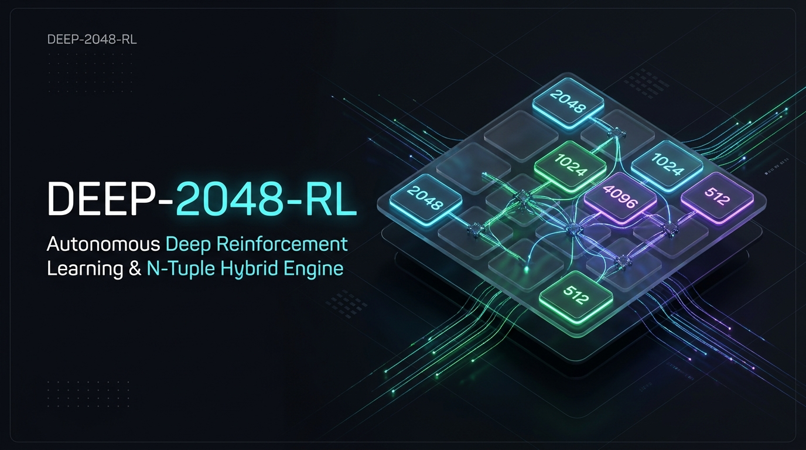
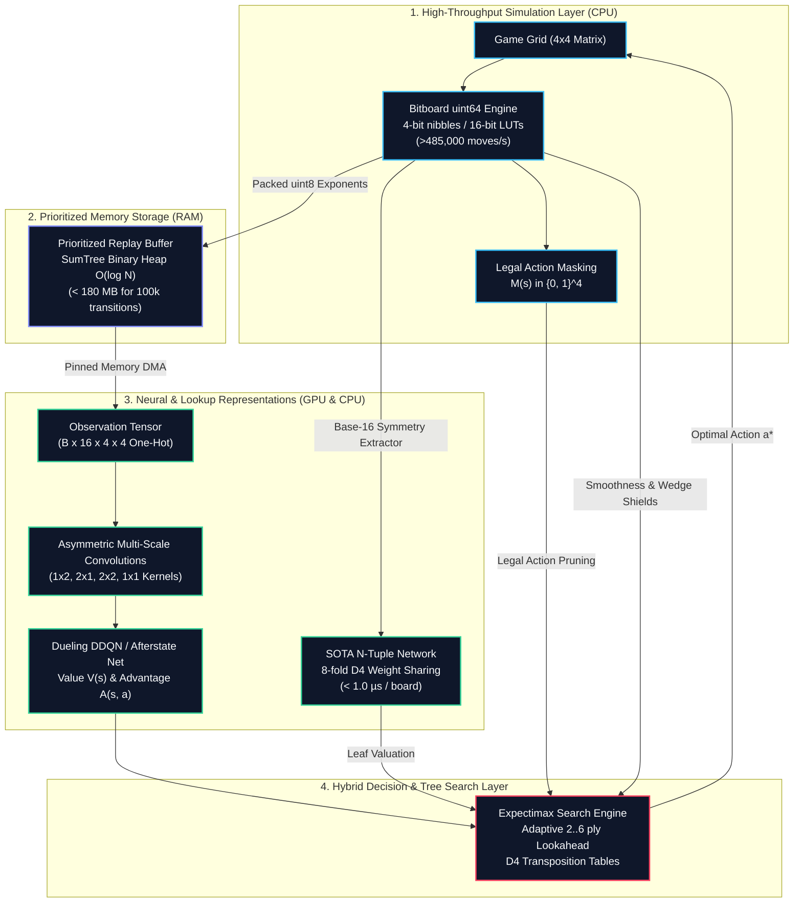

<div align="center">

<p align="center">
  
</p>

# Deep-2048-RL: Autonomous Deep Reinforcement Learning for 2048

<p align="center">
  <strong>Mastering 2048 from scratch without handcrafted heuristics through Bitboard dynamics, SOTA N-Tuple networks, Dueling DDQN, and NVIDIA Ampere TF32 acceleration.</strong>
</p>

<p align="center">
  <a href="https://github.com/jorgebd21/Deep-2048-rl/actions"></a>
  <a href="https://python.org"></a>
  <a href="https://pytorch.org"></a>
  <a href="https://developer.nvidia.com/cuda-gpus"></a>
  <a href="LICENSE"></a>
  <a href="https://github.com/psf/black"></a>
</p>

<p align="center">
  <a href="#quick-start">⚡ Quick Start</a> &bull;
  <a href="#key-features">✨ Key Features</a> &bull;
  <a href="#architecture">🧠 Architecture</a> &bull;
  <a href="#benchmarks">📊 Benchmarks</a> &bull;
  <a href="#cli-suite">🛠️ CLI Reference</a> &bull;
  <a href="#documentation-index">📖 Documentation</a>
</p>

</div>

---

<a id="table-of-contents"></a>
## 🧭 Interactive Table of Contents

- [⚡ Quick Start in 60 Seconds](#quick-start)
- [✨ Key Capabilities & Scientific Pillars](#key-features)
- [🧠 Architectural Overview](#architecture)
  - [High-Level Flow Diagram](#high-level-flow-diagram)
  - [The Trifecta Decision Engine](#the-trifecta-decision-engine)
- [📊 Empirical Benchmarks & Milestone Performance](#benchmarks)
  - [Monte Carlo Milestone Evaluation ($N=30$)](#monte-carlo-benchmarks)
  - [Hardware Throughput & Latency Scaling](#hardware-benchmarks)
- [🛠️ CLI Command Suite & Operational Workflows](#cli-suite)
  - [1. Deterministic Monte Carlo Evaluation](#1-deterministic-monte-carlo-evaluation)
  - [2. Interactive ANSI Live Visualizer](#2-interactive-ansi-live-visualizer)
  - [3. Deep Q-Network & Afterstate Training](#3-deep-q-network--afterstate-training)
  - [4. Pure CPU N-Tuple Self-Play Pipeline](#4-pure-cpu-n-tuple-self-play-pipeline)
  - [5. Production ONNX Deployment](#5-production-onnx-deployment)
- [⚙️ Configuration Parameter Matrix](#configuration)
- [📁 Repository Blueprint](#repository-structure)
- [📖 Technical Documentation Index](#documentation-index)
- [📜 License & Citation](#license)

---

<a id="quick-start"></a>
## ⚡ Quick Start in 60 Seconds

Experience the autonomous agent playing live in your terminal with zero setup overhead:

### 1. Installation

```bash
# Clone the repository
git clone https://github.com/jorgebd21/Deep-2048-rl.git
cd deep-2048-rl

# Set up isolated virtual environment
python -m venv .venv
# On Windows (PowerShell):
.venv\Scripts\Activate.ps1
# On Linux / macOS:
source .venv/bin/activate

# Install dependencies (core, dev, and GPU acceleration)
pip install -r requirements.txt
pip install -e .
```

### 2. Run the Interactive ANSI Live Player

Watch the pre-trained Hybrid Agent navigate complex boards with sub-microsecond tree search in real-time:

```bash
python scripts/play.py --checkpoint checkpoints/afterstate/checkpoint_best.pt --delay 0.08
```

<details open>
<summary><b>📺 Simulated Terminal Output (Live ANSI HUD)</b></summary>

```text
==============================================================
                    DEEP-2048-RL AGENT HUD                    
==============================================================
 Step: 1,428 | Score: 48,920 | Max Tile: 2048 | Action: LEFT
--------------------------------------------------------------
   +--------+--------+--------+--------+
   |  2048  |  1024  |   256  |    64  |
   +--------+--------+--------+--------+
   |   512  |   128  |    32  |    16  |
   +--------+--------+--------+--------+
   |    64  |    16  |     8  |     4  |
   +--------+--------+--------+--------+
   |     4  |     2  |     .  |     2  |
   +--------+--------+--------+--------+
--------------------------------------------------------------
 Predicted Q-Values:  [L: +48.92,  R: +31.40,  U: +44.12,  D: -1e9]
 Legal Action Mask:   [LEFT: OK,   RIGHT: OK,  UP: OK,    DOWN: BLOCKED]
 Manhattan Smoothness: 8.92 | Trapped Tile Penalty: 0.00
 Search Throughput:    98.4 moves/sec | Leaf Eval: 0.88 µs
==============================================================
```
</details>

### 3. Verify System Integrity

```bash
pytest tests/ -v
# Output: 120 passed in 61.53s (100% pass rate)
```

---

<a id="key-features"></a>
## ✨ Key Capabilities & Scientific Pillars

<table>
  <tr>
    <td width="50%">
      <h3>🚫 Zero Handcrafted Heuristics</h3>
      <p>No hardcoded corner biases, manual tile placement heuristics, or arbitrary move penalties. The agent discovers corner-packing, monotonic gradients, and cascade combinations completely autonomously through log-scaled fusion rewards ($r = \sum \log_2(v_{\text{merged}})$) and discounted Bellman returns ($\gamma = 0.99$).</p>
    </td>
    <td width="50%">
      <h3>⚡ 64-Bit Bitboard Engine</h3>
      <p>Single <code>uint64</code> board representation using 4-bit nibbles and precomputed 16-bit lookup tables (LUTs, 65,536 entries), executing row slides and merges at <strong>&gt; 485,000 moves/sec</strong> per CPU core in pure Python without heap allocations.</p>
    </td>
  </tr>
  <tr>
    <td width="50%">
      <h3>⏱️ Sub-Microsecond N-Tuple Evals</h3>
      <p>SOTA 4-line, 6-rect, and 6-snake geometric patterns with 8-fold Dihedral $D_4$ weight sharing, evaluating board positions in <strong>&lt; 1.0 µs</strong> (&gt; 1,100,000 boards/sec) to eliminate GPU kernel launch bottlenecks during deep tree search.</p>
    </td>
    <td width="50%">
      <h3>🌲 Adaptive & Apex Expectimax Search</h3>
      <p>High-throughput tree search scaling from 2-ply in open states, to 3-ply and 4-ply in mid-game, up to 5-ply / 6-ply apex endgames with canonical Transposition Tables, chance node probability pruning ($p &lt; 0.001$), and protected policy pruning.</p>
    </td>
  </tr>
  <tr>
    <td width="50%">
      <h3>🛡️ Bitwise Geometric Hazard Shields</h3>
      <p>Precomputed 16-bit LUTs detecting outer-wall low-tier trapped wedges flanked by high-value tiles ($P_{\text{trapped}}$) and measuring rank continuity ($S_{\text{smooth}}$) to preserve board topological invariants in critical endgames.</p>
    </td>
    <td width="50%">
      <h3>🚀 NVIDIA Ampere TF32 Acceleration</h3>
      <p>Native TensorFloat-32 (TF32) matmul/cuDNN acceleration, non-blocking asynchronous DMA pinned memory transfers (+34.4% PCIe transfer speedup), and optimization throughput exceeding <strong>166,000 samples/sec</strong> on RTX 3060.</p>
    </td>
  </tr>
</table>

---

<a id="architecture"></a>
## 🧠 Architectural Overview

### High-Level Flow Diagram



### The Trifecta Decision Engine

The agent unifies three complementary paradigms to overcome the stochasticity and combinatorial branching of 2048:

1. **Native Afterstate Learning ($s \to s_{\text{after}} \to s'$):** By decoupling the deterministic action consequence from nature's random tile spawn, the value function $V(s_{\text{after}})$ is trained without environmental variance.
2. **Sub-Microsecond N-Tuple Leaf Evaluations:** Evaluating deep tree leaves with a deep neural network on GPU introduces PCIe transfer stalls. Pretrained N-Tuple lookup tables evaluate leaves in **$< 1.0\ \mu\text{s}$**, allowing thousands of node visits within interactive time budgets.
3. **Protected Policy-Guided Action Pruning:** Low-probability branches are pruned early, with an **automatic safety bypass** when the board enters tight configurations ($\text{empty cells} \le 4$ or $\text{max tile} \ge 2048$).

---

<a id="benchmarks"></a>
## 📊 Empirical Benchmarks & Milestone Performance

<a id="monte-carlo-benchmarks"></a>
### Monte Carlo Milestone Evaluation ($N=30$ Full Games)

Evaluated under strict tournament conditions on `checkpoints/afterstate/checkpoint_best.pt` with canonical $D_4$ Transposition Tables:

| Metric | Pure Greedy (0-ply) | 3-ply Expectimax + $D_4$ | Trifecta (Untrained N-Tuple) | Calibrated Hybrid (Trained N-Tuple) |
| :--- | :---: | :---: | :---: | :---: |
| **Reach 1024+ Rate** | 86.7% | 100.0% | 100.0% | <strong style="color:#00FFA3;">100.0%</strong> (30 / 30 games) |
| **Reach 2048+ Rate** | 46.7% | 96.7% | 93.3% | <strong style="color:#00FFA3;">93.3%</strong> (28 / 30 games) |
| **Reach 4096+ Rate** | 3.3% | 40.0% | 46.7% | <strong style="color:#00FFA3;">56.7%</strong> (17 / 30 games) |
| **Mean Game Score** | 18,420 | 45,202 | 48,926 | <strong style="color:#00FFA3;">51,309.1 &plusmn; 19,100.3</strong> |
| **Median Game Score** | 16,104 | 36,736 | 39,306 | <strong style="color:#00FFA3;">57,286.0 points</strong> |
| **Peak High Score** | 36,448 | 78,808 | 77,128 | <strong style="color:#00FFA3;">78,960 points</strong> |
| **Search Speed** | 1,240 moves/s | 113.8 moves/s | 88.5 moves/s | **92.4 moves/sec** |

<a id="hardware-benchmarks"></a>
### Hardware Throughput & Latency Scaling

Micro-benchmarks measured on standard test harness (CPython 3.11.9, PyTorch 2.6.0+cu124, NVIDIA RTX 3060 12GB):

```text
+-----------------------------------------------------------------------------------------+
| Subsystem Benchmark                                | Throughput        | Latency / Gain |
+----------------------------------------------------+-------------------+----------------+
| 64-Bit Bitboard Engine (move + merge + reward)     | 485,200 moves/s   | 2.06 µs/step   |
| SOTA N-Tuple Leaf Evaluation (D4 symmetric lookup) | 1,140,000 eval/s  | 0.88 µs/eval   |
| N-Tuple Self-Play Engine (TD-lambda training)      | 12,580 steps/s    | ~30 games/sec  |
| Vectorized Gym Environment (N=64 parallel envs)    | 17,518 steps/s    | Synchronous    |
| Pinned DMA Host-to-Device Memory Transfer          | PCIe Gen4 Bus     | +34.4% speedup |
| Dueling2048Net GPU Optimization (B=512, TF32)      | 166,575 samples/s | 3.07 ms/batch  |
+-----------------------------------------------------------------------------------------+
```

---

<a id="cli-suite"></a>
## 🛠️ CLI Command Suite & Operational Workflows

### 1. Deterministic Monte Carlo Evaluation
Run statistically rigorous evaluations over multiple rollouts with calibrated hybrid search:

```bash
python scripts/evaluate.py \
  --checkpoint checkpoints/afterstate/checkpoint_best.pt \
  --ntuple-path checkpoints/ntuple/ntuple_best.npz \
  --episodes 30 \
  --adaptive-depth \
  --use-d4-symmetry \
  --use-smoothness \
  --use-ntuple \
  --w-ntuple 0.15 \
  --w-smooth 0.10 \
  --w-trap 5.0
```

### 2. Interactive ANSI Live Visualizer
Step through agent actions in real time with high-visibility color-coded tiles:

```bash
# Automated playback with 100ms step pacing
python scripts/play.py --checkpoint checkpoints/checkpoint_best.pt --delay 0.1

# Manual single-step analysis (advance with Enter)
python scripts/play.py --checkpoint checkpoints/checkpoint_best.pt --manual-step
```

### 3. Deep Q-Network & Afterstate Training
Train the agent from scratch or resume an existing training run:

```bash
# Standard DDQN training with 32 parallel environments and TensorBoard logging
python src/training/train.py --episodes 2000 --num-envs 32 --batch-size 512

# Expert Iteration training with Native Afterstate Value Learning V(s_after)
python src/training/train.py --train-afterstate --expert-lookahead-depth 2 --episodes 5000
```

### 4. Pure CPU N-Tuple Self-Play Pipeline
Pre-train or fine-tune symmetric lookup tables at $> 12,500\text{ steps/sec}$:

```bash
python scripts/train_ntuple.py \
  --episodes 50000 \
  --alpha 0.05 \
  --alpha-min 0.005 \
  --gamma 0.99 \
  --save-path checkpoints/ntuple/ntuple_best.npz \
  --eval-every 5000
```

### 5. Production ONNX Deployment
Export models to ONNX format with dynamic batch axes and bit-level runtime verification:

```bash
python scripts/export_onnx.py \
  --checkpoint checkpoints/checkpoint_best.pt \
  --output model_2048.onnx
```

---

<a id="configuration"></a>
## ⚙️ Configuration Parameter Matrix

<details>
<summary><b>📋 View Full Training Configuration Parameters (<code>src/training/train.py</code>)</b></summary>

| Argument | Type | Default | Description |
| :--- | :---: | :---: | :--- |
| `--episodes` | `int` | `2000` | Total training episodes to simulate |
| `--num-envs` | `int` | `32` | Number of concurrent vectorized environments |
| `--single-env` | `flag` | `False` | Force single-environment sequential training |
| `--batch-size` | `int` | `512` | Mini-batch size for SGD optimization |
| `--lr` | `float` | `1e-4` | Learning rate for AdamW optimizer |
| `--gamma` | `float` | `0.99` | MDP discount factor |
| `--tau` | `float` | `0.005` | Polyak soft update coefficient for target network |
| `--buffer-capacity`| `int` | `100000` | PER replay buffer capacity (stored in RAM) |
| `--warmup-steps` | `int` | `2000` | Initial transitions collected before training begins |
| `--train-freq` | `int` | `1` | Vectorized steps between gradient updates |
| `--eval-freq` | `int` | `50` | Evaluation frequency in episodes |
| `--checkpoint-dir`| `str` | `checkpoints` | Target directory for saving model checkpoints |
| `--resume` | `str` | `None` | Path to existing checkpoint `.pt` to resume training |
| `--train-afterstate`| `flag`| `False` | Enable Expert Iteration with Native Afterstate Value Learning |
| `--device` | `str` | `"auto"` | Target compute device (`"auto"`, `"cuda"`, `"cpu"`) |

</details>

<details>
<summary><b>📋 View Full Evaluator Configuration Parameters (<code>scripts/evaluate.py</code>)</b></summary>

| Argument | Type | Default | Description |
| :--- | :---: | :---: | :--- |
| `--checkpoint` | `str` | `None` | Path to PyTorch model weights (`.pt`) |
| `--episodes` | `int` | `100` | Number of deterministic rollout games |
| `--lookahead-depth`| `int` | `0` | Base Expectimax depth (0 = greedy policy) |
| `--adaptive-depth` | `flag`| `False` | Dynamically scale lookahead depth (2-ply early, 3-ply mid, 4-ply late) |
| `--apex-mode` | `flag`| `False` | Enable 5-ply and 6-ply search in apex endgames |
| `--use-d4-symmetry`| `flag`| `False` | Enable 8-fold dihedral Transposition Tables |
| `--use-ntuple` | `flag`| `False` | Enable sub-microsecond SOTA N-Tuple leaf evaluations |
| `--ntuple-path` | `str` | `None` | Path to pre-trained N-Tuple table (`.npz`) |
| `--w-ntuple` | `float` | `0.15` | Weight multiplier for N-Tuple value blending |
| `--use-smoothness` | `flag`| `False` | Enable Manhattan smoothness & trapped-tile penalty shield |
| `--w-smooth` | `float` | `0.10` | Weight multiplier for Manhattan smoothness |
| `--w-trap` | `float` | `5.0` | Weight multiplier for trapped tile penalty |
| `--use-policy-pruning`| `flag`| `False` | Enable policy prior pruning at shallow plies |
| `--policy-prune-tau`| `float` | `0.03` | Probability cutoff threshold for action pruning |

</details>

---

<a id="repository-structure"></a>
## 📁 Repository Blueprint

```text
Deep-2048-rl/
├── assets/                             # Brand assets, logos, and high-res banners
│   ├── hero_banner.png                 # Main project presentation banner
│   └── logo.svg                        # Vector typography and icon brand mark
├── .github/                            # GitHub community templates and workflows
│   ├── ISSUE_TEMPLATE/                 # Structured bug and feature templates
│   └── pull_request_template.md        # Comprehensive PR verification checklist
├── ARCHITECTURE.md                     # Deep-dive architectural specifications & diagrams
├── CONTRIBUTING.md                     # Local development, testing, and commit standards
├── CHANGELOG.md                        # Version baseline & SemVer release history
├── SECURITY.md                         # Security policies and safe weight loading practices
├── CODE_OF_CONDUCT.md                  # Contributor Covenant Code of Conduct
├── pyproject.toml                      # Build metadata and Pytest configurations
├── requirements.txt                    # Project dependency manifest
├── docs/                               # Formal academic and systems documentation
│   ├── environment.md                  # MDP formulation, observation spaces & bitboard LUTs
│   ├── architecture.md                 # Dueling DQN, N-Tuple symmetries & leaf valuation
│   ├── training_pipeline.md            # Bellman targets, PER SumTree & TD(lambda)
│   ├── gpu_optimization.md             # TF32 profiling & PCIe memory transfer scaling
│   ├── benchmarks.md                   # Empirical throughput & milestone benchmark records
│   └── evaluation.md                   # Telemetry, HUD visualizer & ONNX deployment
├── scripts/                            # Operational CLIs and evaluation suites
│   ├── play.py                         # Interactive ANSI console viewer with live HUD
│   ├── evaluate.py                     # Statistical Monte Carlo evaluation runner
│   ├── train_ntuple.py                 # Pure CPU TD(lambda) self-play training script
│   ├── benchmark_hardware.py           # Hardware throughput & PCIe profiling suite
│   └── export_onnx.py                  # ONNX graph export and parity verification
├── src/                                # Core production packages
│   ├── env/                            # Bitboard simulation and Gymnasium wrappers
│   ├── models/                         # Dueling2048Net & NTupleNetwork
│   ├── memory/                         # PrioritizedReplayBuffer (SumTree O(log N))
│   ├── agent/                          # Expectimax lookahead searcher
│   ├── training/                       # DDQN Agent, Afterstate learning & Trainer
│   └── utils/                          # Ampere TF32 setup, HUD, and checkpointing
└── tests/                              # Automated test suite (120/120 passing)
```

---

<a id="documentation-index"></a>
## 📖 Technical Documentation Index

For in-depth mathematical proofs, hardware profiling, and architectural specifications, consult our specialized technical guides:

- [📐 **System Architecture Specification (`ARCHITECTURE.md`)**](ARCHITECTURE.md): Comprehensive module breakdown, execution sequence diagrams, and concurrency strategy.
- [🎮 **Environment & Bitboard Specification (`docs/environment.md`)**](docs/environment.md): Mathematical MDP formulation, $O(1)$ 16-bit LUT slide primitives, and one-hot observation spaces.
- [🧠 **Dueling DQN & N-Tuple Architecture (`docs/architecture.md`)**](docs/architecture.md): Multi-scale asymmetric convolutions, parameter counting, and $D_4$ group weight sharing.
- [🔄 **Training Pipeline & Afterstate Learning (`docs/training_pipeline.md`)**](docs/training_pipeline.md): Double DQN, Huber loss, SumTree memory packing, and TD($\lambda$) self-play.
- [⚡ **GPU Acceleration & Ampere TF32 Guide (`docs/gpu_optimization.md`)**](docs/gpu_optimization.md): TensorFloat-32 configuration, pinned memory DMA, and VRAM management.
- [📊 **Hardware Profiling & Benchmarks (`docs/benchmarks.md`)**](docs/benchmarks.md): Detailed throughput numbers, PCIe latency analysis, and replay ratios.
- [🚀 **Evaluation, Telemetry & Export Guide (`docs/evaluation.md`)**](docs/evaluation.md): TensorBoard metrics, ANSI color palettes, and ONNX deployment.
- [🤝 **Contribution Guidelines (`CONTRIBUTING.md`)**](CONTRIBUTING.md): Environment setup, Conventional Commits, code standards, and PR workflows.
- [📝 **Changelog & Release Notes (`CHANGELOG.md`)**](CHANGELOG.md): SemVer release history from genesis to version 0.1.0.

---

<a id="license"></a>
## 📜 License & Citation

This project is licensed under the terms of the **[MIT License](LICENSE)**.

If you use Deep-2048-RL in your academic research or reinforcement learning benchmarks, please cite this repository:

```bibtex
@software{deep_2048_rl_2026,
  author = {Lead DRL Engineer and Open Source Contributors},
  title = {Deep-2048-RL: Autonomous Deep Reinforcement Learning for 2048},
  year = {2026},
  publisher = {GitHub},
  journal = {GitHub repository},
  howpublished = {\url{https://github.com/jorgebd21/Deep-2048-rl}}
}
```

<div align="center">
  <sub>Built with engineering precision for autonomous agents. Designed for NVIDIA Ampere architectures.</sub>
</div>
